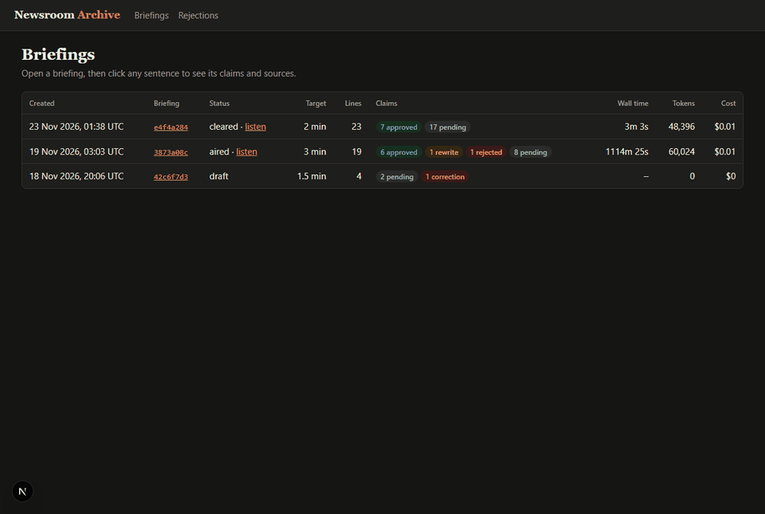
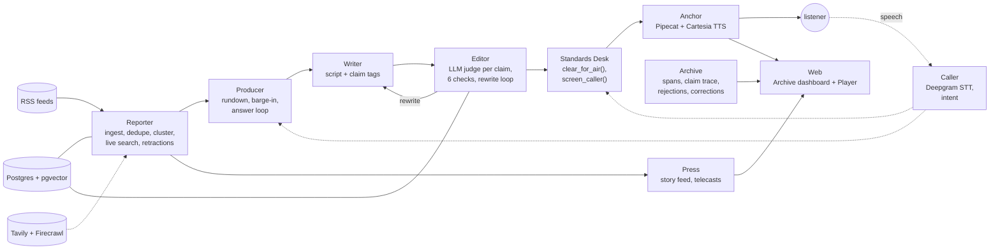

# Newsroom

A voice-first AI news anchor. It fetches live news, writes a broadcast script, fact-checks every
claim against its sources with an LLM judge, and reads the brief aloud. Listeners interrupt with a
spoken question, get a sourced answer, and the briefing resumes.

The rule the whole system is built around: **no sentence reaches the Anchor unless every claim in it
has `verdict = approved` and at least one stored evidence passage.** The Standards Desk enforces it
with a type (`ClearedScript`) that only `clear_for_air()` can build, and the Archive traces any
spoken sentence back to its source URL in one click.



Frames from the web app on 2026-11-23, live data: a Press feed card, then the telecast of one story (the
intro bumper, the anchor in the studio with the headline lower third and word-highlighted captions, the
B-roll cut, and the countdown to the next story). Every spoken line of a telecast was approved by the
Editor and cleared by the Standards Desk; the full trace is in the Archive at `/archive`.

## Architecture

Each box is a folder under `app/` (the web app is `web/`). Solid arrows are the briefing path,
dotted arrows the live question path.



- **Reporter** pulls RSS, dedupes by URL and content hash, embeds (Voyage) and clusters sources into
  stories. For questions it searches the live web. `newsroom retract` / `recheck` mark withdrawn
  sources and record corrections.
- **Producer** picks the top fresh stories and splits the time, handles barge-in, and runs the
  answer loop inside a latency budget (a safe line is spoken if the budget runs out).
- **Writer** drafts the script and tags every factual claim with the sources it came from.
- **Editor** retrieves evidence passages for each claim (pgvector, cited and non-retracted sources
  only) and an LLM judge answers six checks: supported, faithful, attributed, fresh, corroborated
  (sensitive claims need two outlets) and consistent (sources disagree). Failed claims go back to the
  Writer for up to two rewrite rounds.
- **Standards Desk** clears lines for air (approved claims with evidence, no injected instructions,
  numbers and names traceable to evidence) and screens callers' questions. Corrections for retracted
  sources air first, from a fixed template.
- **Anchor** voices cleared lines with Cartesia through Pipecat and records per-line audio timestamps.
- **Caller** transcribes questions with Deepgram and classifies the intent.
- **Press** serves the story feed with crawler summaries and runs telecasts: one story through the whole path,
  voiced once to an audio file the web player streams.
- **Archive** records a span for every step (latency, tokens, cost) in Postgres, and serves the
  claim trace, rejection log and corrections. LLM calls also go to Langfuse when configured.

Every LLM call goes through one gateway (`app/shared/llm/`) with routing, retries, structured output
and cost accounting. Fetched web content is treated as data and never goes into a system prompt.
Design decisions are in [`context/decisions/`](context/decisions/).

## Press and telecasts (web app)

The web app (`web/`, Next.js) has three parts:

- **Press** (`/`): a full-screen card feed of the stories the Reporter gathered, newest first. Each card has the
  feed thumbnail (credited to the outlet), a ~60-word summary written by the Writer from the sources (labelled
  "not yet fact-checked"; it paraphrases and is checked against copying), the outlets and the source links.
  Wheel, arrow keys, space, or swipe to move.
- **Telecast** (`/watch/<story>`): "Watch broadcast" runs the full pipeline on that one story (Writer, Editor
  judge with rewrites, Standards Desk, Anchor voice) in about a minute and plays it as a TV segment: bumper,
  animated anchor with lip sync from the TTS's word timings, lower thirds with the fact-check count, B-roll,
  ticker, captions, and a countdown to the next story. Pause, seek, speed and replay keep audio and animation
  together (one show clock); without audio it runs captions-only. Phones held upright get the picture with a
  readable panel under it. Telecast audio is MP3 (about 0.5 MB a minute), kept 7 days (`newsroom cleanup-media`;
  the worker cleans daily). With the ARQ worker running, telecasts run there; otherwise in the API process.
- **Archive** (`/archive`): every briefing and telecast, each sentence traced to its claims, verdicts and sources.

Design notes: [`FRONTEND_PLAN.md`](FRONTEND_PLAN.md) and decisions 0026 to 0028.

## Eval numbers

Judge model `openai/gpt-oss-120b` on Groq. A claim is *flagged* when the judge does not approve it.

| Eval | Prompt | Result |
| --- | --- | --- |
| `judge_v1`: 100 labelled claims + 30 planted falsehoods | `dad2a081` | catch rate 1.00 (30/30), precision 0.904, recall 0.971, false flag rate 0.113 |
| `judge_v1` with the `consistent` check and the narrower `attributed` rule | `f780696a` | catch rate 1.00 (30/30), precision 0.955, recall 0.941, false flag rate 0.048 |
| `contradictions_v1`: 28 claims where outlets disagree | `f780696a` | contradicted claims caught 12/12, attributed disagreements approved 5/6, precision 0.923 |
| `redteam_v1`: Standards Desk rules (offline, gates CI) | - | 22/24 attacks blocked, 0/9 false blocks (2 known gaps) |
| `redteam_v1`: full caller screen (rules + LLM) | - | 27/28 attacks blocked, 1/15 harmless questions blocked |
| `redteam_v1`: judge on satire, stale and injected passages | `f780696a` | 14/15 attacks caught (the stale miss did not repeat in 5 reruns), 1/5 controls flagged |

Remaining misses: one claim stated as fact that only a company said, and sensitive claims cited by a single outlet.
Results, per case, are in [`evals/results/`](evals/results/).

```bash
uv run python evals/run_evals.py                      # judge_v1 (resumes a partial run)
uv run python evals/run_evals.py --data evals/data/contradictions_v1.json
uv run python evals/run_redteam.py [--live]           # offline part runs in CI
```

## Latency

p50 and p95 per stage from the spans recorded on the dev database (`uv run python
evals/run_latency.py`, 2026-11-22). Sample sizes are small; the judge numbers include waits on the
Groq free tier's per-minute token limit: a judge call that goes through on the first attempt takes
p50 1.6 s, p95 2.0 s (n = 13).

| Path | Stage | n | p50 | p95 |
| --- | --- | --- | --- | --- |
| briefing | Fetch and dedupe RSS feeds | 5 | 2.0 s | 2.3 s |
| briefing | Write the script | 2 | 15.4 s | 19.2 s |
| briefing | Judge one claim | 50 | 22.3 s | 45.3 s |
| briefing | Judge every claim + rewrite loop | 2 | 172.7 s | 174.8 s |
| briefing | Clear for air | 24 | 634 ms | 802 ms |
| briefing | Voice one line (TTS) | 60 | 4.1 s | 6.8 s |
| answer | Classify + screen a question (after STT) | 17 | 1.1 s | 1.5 s |
| answer | Question to cleared answer | 2 | 9.8 s | 12.6 s |

## Run

Requires Python 3.12, [uv](https://docs.astral.sh/uv/), Docker and Node 24 (what CI uses). Copy `.env.example` to
`.env` and fill in the keys you have (Groq, Voyage, Deepgram, Cartesia; Tavily and Firecrawl for
live search; OpenRouter optional, as the judge's fallback host when Groq rate-limits; Langfuse optional).

```bash
docker compose up -d db redis       # Postgres 16 + pgvector, Redis 7
uv sync                             # install dependencies
uv run alembic upgrade head         # create the schema
uv run newsroom stories --top 10    # ingest and cluster today's stories
uv run newsroom brief --minutes 3   # rundown, script, fact-check; prints each claim's verdict
uv run newsroom speak <briefing_id> --out brief.wav
uv run fastapi dev app/main.py      # API on :8000
cd web && npm ci && npm run dev     # Press feed on :3000, Archive at /archive
```

Other commands: `newsroom ask --briefing <id> --wav q.wav` (transcribe and classify a question),
`newsroom search "<question>"` (live web search), `newsroom retract <source id|url> --reason "..."`,
`newsroom recheck`, `newsroom corrections`, `newsroom summarize` (Press feed summaries; the worker also writes them).

### Web app and backend together

1. Start Postgres (`docker compose up -d db redis`) and migrate (`uv run alembic upgrade head`).
2. Fill the feed: `uv run python -m app.reporter` (fetch, embed, cluster) then `uv run newsroom summarize`, or run
   the worker, which does both every 15 minutes and rechecks sources for retractions every 6 hours:
   `uv run arq app.worker.WorkerSettings` (needs Redis).
3. Start the API: `uv run fastapi dev app/main.py` (port 8000). Telecasts run inside it and write audio to
   `var/media/`, served at `/media`.
4. Start the web app: `cd web && npm ci && npm run dev` (port 3000). It reaches the API through its own `/api` and
   `/media` rewrites, so no CORS setup is needed. Point it elsewhere with `NEWSROOM_API_URL`
   (see `web/.env.example`).

Keys: Groq for the Writer and Editor (OpenRouter as the judge's fallback), Voyage for embeddings, Cartesia for the
anchor's voice (`NEWSROOM_ANCHOR_TTS=fake` gives a silent anchor, and the telecast then runs captions-only
timing), Deepgram for spoken questions in the briefing Player.

## Develop

```bash
uv run pytest -q                    # tests
uv run ruff check . && uv run ruff format --check .
uv run mypy app
python scripts/context_graph.py check
```

Integration tests (`tests/integration/`) run when `NEWSROOM_TEST_DATABASE_URL` points at a
throwaway Postgres with pgvector; they wipe that database. Otherwise they are skipped.

Project memory for coding agents lives in [`context/`](context/): `STATE.md` (progress and handoff),
`GRAPH.md` (components and their edges) and one node file per component. Rules are in
[`AGENTS.md`](AGENTS.md).
