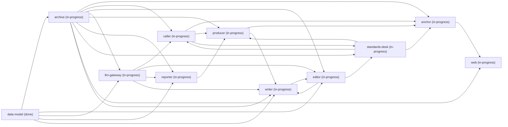

# GRAPH

Index of the context graph. Each node is a file in `context/nodes/`; edges come from node frontmatter
(`depends_on`, `feeds`). The block below is generated by `python scripts/context_graph.py build`.
Do not edit it by hand.

How to use it: find the node your task changes, then read that node plus its direct neighbours.
Decisions are in `context/decisions/`, current progress in `context/STATE.md`.

<!-- graph:start -->

## Nodes

| Node | Type | Status | Phase | Code | Depends on | Feeds | Decisions |
| --- | --- | --- | --- | --- | --- | --- | --- |
| [archive](nodes/archive.md) | component | in-progress | 1 | `app/archive/` | data-model | web | 0005, 0009, 0013 |
| [data-model](nodes/data-model.md) | shared | done | 1 | `app/db/` | - | reporter, writer, editor, archive | 0001, 0007, 0011 |
| [llm-gateway](nodes/llm-gateway.md) | shared | in-progress | 1 | `app/shared/llm/` | archive, data-model | reporter, writer, editor, caller | 0002, 0005, 0007, 0008, 0014, 0015 |
| [reporter](nodes/reporter.md) | component | in-progress | 1 | `app/reporter/` | data-model, llm-gateway, archive | producer | 0003, 0010 |
| [editor](nodes/editor.md) | component | in-progress | 2 | `app/editor/` | writer, llm-gateway, data-model, archive | standards-desk, writer | 0002, 0012, 0013, 0014 |
| [producer](nodes/producer.md) | component | in-progress | 2 | `app/producer/` | reporter, caller, standards-desk, archive | writer, anchor | - |
| [writer](nodes/writer.md) | component | in-progress | 2 | `app/writer/` | producer, editor, llm-gateway, data-model, archive | editor | 0002, 0011, 0013, 0014 |
| [anchor](nodes/anchor.md) | component | in-progress | 4 | `app/anchor/` | standards-desk, producer, caller, archive | web | 0004, 0016, 0017 |
| [standards-desk](nodes/standards-desk.md) | component | in-progress | 4 | `app/standards_desk/` | editor, caller, archive | anchor, producer, caller | 0016, 0019 |
| [web](nodes/web.md) | app | in-progress | 4 | `web/` | anchor, archive | - | - |
| [caller](nodes/caller.md) | component | in-progress | 5 | `app/caller/` | archive, llm-gateway, standards-desk | standards-desk, producer, anchor | 0004, 0018, 0019 |

## Edges

<!-- graph:end -->
